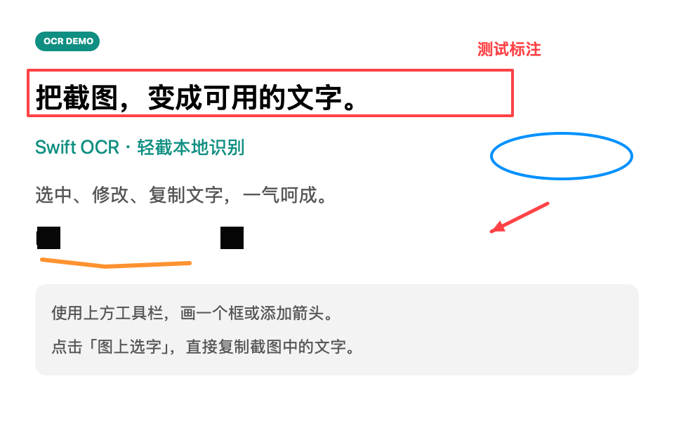

# 轻截 · LightShotMac

原生 macOS 截图工具，参考微信截图的常用操作，支持区域截图、标注修改、本地 OCR，以及直接复制图片中的文字。

**适用环境：Apple Silicon Mac（M1 / M2 / M3 / M4 等），macOS 14 或更新版本。**

[下载最新版本](https://github.com/zwkere/LightShotMac/releases/latest) · [v1.1.0 下载](https://github.com/zwkere/LightShotMac/releases/download/v1.1.0/LightShot-1.1.0-macOS-arm64.zip)

## 功能

- **区域截图**：全局快捷键或菜单栏图标唤起，拖动选择区域，保留 Retina 像素分辨率。
- **标注修改**：矩形、圆形、箭头、画笔、文字、马赛克；调整颜色与粗细；拖动、删除、撤销、重做标注。
- **图片复制与保存**：一键复制编辑后的图片，或保存为 PNG。
- **中英文 OCR**：截图后自动识别，也可打开或粘贴已有图片。
- **可编辑文字面板**：选择、修改并复制识别结果，或一键复制全文。
- **图上选字**：点击一行或框选多行，松开鼠标自动复制识别内容。
- **自定义快捷键**：保存后立即生效，重启后保留，支持恢复默认和注册冲突提示。

OCR 使用 Apple Vision 在本机完成。应用没有上传、遥测、自动更新或第三方 SDK。

### 标注示例

下面是程序生成的演示图片，展示各类标注的导出效果。



## 下载与使用

1. 从 [Releases](https://github.com/zwkere/LightShotMac/releases/latest) 下载 `LightShot-1.1.0-macOS-arm64.zip` 并解压。
2. 将 `轻截.app` 放到「应用程序」文件夹，然后双击打开。如果被 macOS 拦截，请按下方「首次打开时被 macOS 拦截」说明处理。
3. 首次截图时，在「系统设置 → 隐私与安全性 → 屏幕与系统音频录制」允许轻截，退出后重新打开应用。打开或粘贴已有图片不需要此权限。
4. 按 **Control + Command + A**，拖动选择区域，松开鼠标进入编辑器。Esc 或右键取消截图。
5. 使用上方工具栏添加标注。选择工具下可拖动标注，Delete 删除；双击文字标注可修改。输入后按回车完成。
6. 点击「复制图片」粘贴到微信等应用，或点击「保存」导出 PNG。
7. 右侧 OCR 文字可直接修改；选中文字后按 **Command + C**，或点击「复制全部文字」。
8. 点击「图上选字」，在图片上点击一行或框选多行，松开鼠标自动复制。标注修改后需要更新 OCR 时，点击「重新识别」。

### 首次打开时被 macOS 拦截

**v1.1.0 发布包使用 ad-hoc 本地签名，尚未进行 Apple Developer ID 签名与 Apple 公证。** 从 GitHub 下载后，macOS 通常会阻止首次打开，可能显示“无法验证开发者”或“Apple 无法检查是否包含恶意软件”等提示。

本地签名完整性校验和功能测试通过，并不意味着能通过 Gatekeeper 的首次打开检查。当前版本也没有获得 Apple 对开发者身份的验证及公证检查；下载者需要自行判断是否信任软件来源。

如果你确认下载自本仓库的 [Releases](https://github.com/zwkere/LightShotMac/releases/latest)、文件未被篡改，并决定继续使用，可按 [Apple 官方说明](https://support.apple.com/zh-cn/102445) 为这个应用单独放行：

1. 先尝试双击打开 `轻截.app`，让 macOS 显示拦截提示。
2. 打开「系统设置 → 隐私与安全性」，向下滚动至「安全性」。
3. 若显示针对轻截的「仍要打开」按钮，点击它，并按系统要求完成身份验证。
4. 在再次出现的确认对话框中，确认后点击「打开」。之后通常可以正常双击启动这个版本的应用。

应用放行后，截图、标注和 OCR 功能可照常使用；**屏幕录制权限仍需要按前面的安装步骤单独开启**。

公司或学校管理的 Mac 可能禁止用户自行放行，或不提供「仍要打开」选项，此时需要联系管理员。上述步骤不要求关闭整个系统的 Gatekeeper，也不要求执行删除安全属性的终端命令。

如果提示明确指出“将损坏你的电脑”或“App 已损坏”，请停止打开，检查下载文件或联系开发者，不要将它当作普通的未公证提示处理。

`SHA256SUMS.txt` 可以帮助核对下载文件是否与发行包一致，但校验值不能替代 Apple 公证或证明软件安全。也可以按照下方「从源码构建」步骤检查并在本机编译应用。

## 设置快捷键

从「轻截 → 设置…」、菜单栏图标 →「设置…」，或主窗口的「设置」按钮打开；也可以按 **Command + 逗号**。

点击快捷键框，按下组合键，再点击「保存」。至少包含 Control、Option、Command 中的一个键，支持字母、数字、方向键与功能键。

- 保存成功立即生效，重启后保留；主窗口、菜单栏菜单与关于窗口的提示同步更新。
- 注册失败时保留原来的快捷键，并提示选择其他组合。
- 常见应用编辑快捷键与 macOS 系统组合会提示避让；其他应用的普通菜单快捷键不一定能被系统注册接口检测到。
- Esc 取消录入；「取消」或关闭设置窗口会丢弃未保存的修改。
- 「恢复默认」将录入值设回 Control + Command + A，点击保存后生效。

| 操作 | 快捷键 |
| --- | --- |
| 全局截图 | 默认 Control + Command + A，可在设置中修改 |
| 打开设置 | Command + 逗号 |
| 应用内新截图 | Command + N |
| 打开图片 | Command + O |
| 复制图片 | Command + Return |
| 复制全部 OCR 文字 | Shift + Command + C |
| 保存 PNG | Command + S |
| 撤销 / 重做标注 | Command + Z / Shift + Command + Z |
| 取消截图 | Esc / 右键 |

## 从源码构建

需要 Apple Silicon Mac、Apple Command Line Tools 和 Swift 编译器。本版本在 macOS 27.0.1、Swift 6.4 上验证。

```sh
git clone https://github.com/zwkere/LightShotMac.git
cd LightShotMac
./build.sh
./test.sh
open dist/轻截.app
```

构建脚本生成 `dist/轻截.app` 并进行本地 ad-hoc 签名，无需 Xcode 工程或额外软件包。

| 路径 | 内容 |
| --- | --- |
| `Sources/` | 应用、截图选区、标注编辑器、OCR 与快捷键设置 |
| `Resources/` | 应用信息、图标与图标生成脚本 |
| `Tests/SelfTest.swift` | 本地功能与快捷键集成检查 |
| `build.sh` | 编译及签名 |
| `test.sh` | 运行检查，生成 `test-results/` |

应用支持 `--demo` 参数，使用生成的中英文演示图片启动编辑器；`--self-test` 运行功能检查后退出。

## 验证与当前限制

v1.1.0 的 **26 项功能检查通过**，覆盖中英文 OCR、数字识别、OCR 坐标、Retina 裁切与方向、零选区拒绝、标注增删与撤销重做、各类标注导出、PNG 编码、快捷键校验与持久化、注册冲突保留、释放旧快捷键，以及 Carbon 热键事件回调。

界面检查覆盖矩形标注、复制图片、图上单行选字并粘贴回文字面板、真实截图进入编辑器并完成 OCR，以及设置录入、保存、重启保留、恢复默认和 Command + 逗号打开设置。

- 多个显示器可分别显示选区遮罩，但本次尚未做多屏实机验证；不支持跨屏拼接一个选区。
- OCR 对模糊、小字、手写文字和复杂排版可能需要手动修正；文字按阅读行输出，不重建表格。
- 首次 OCR 可能因系统加载识别模型而较慢。
- 当前发布包只包含 arm64 架构，未提供 Intel Mac 版本。

## 技术依据

- [Apple ScreenCaptureKit](https://developer.apple.com/documentation/screencapturekit)
- [Apple Vision / VNRecognizeTextRequest](https://developer.apple.com/documentation/vision/vnrecognizetextrequest)
